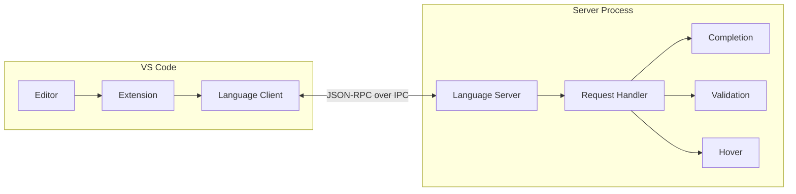
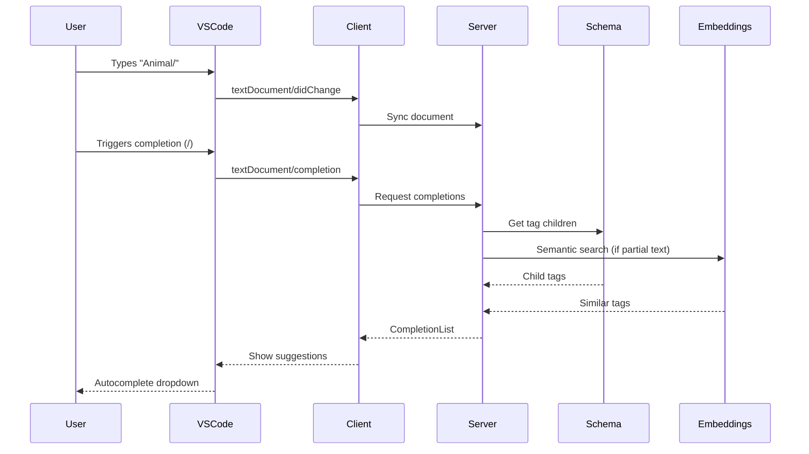
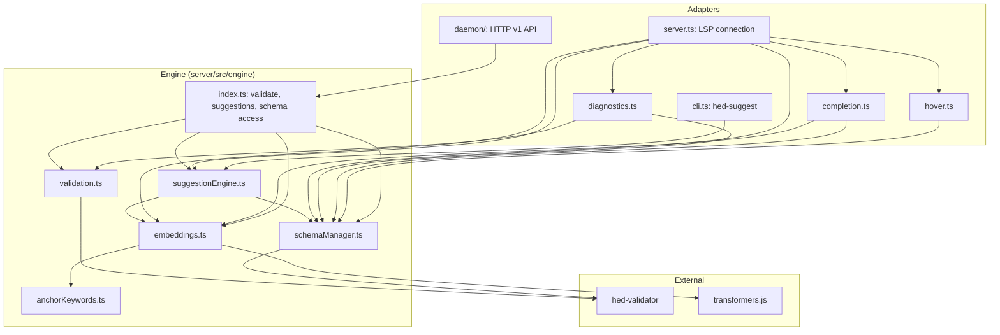
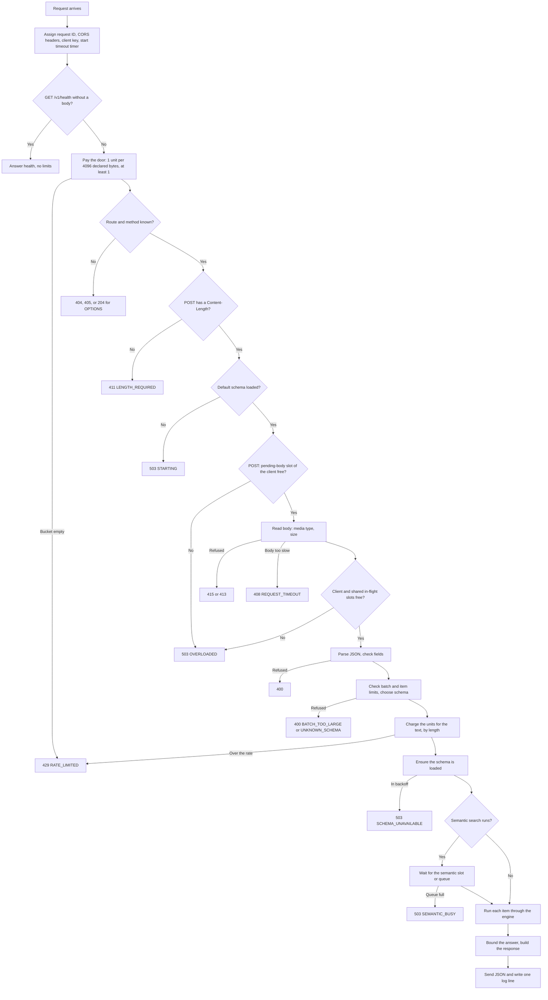
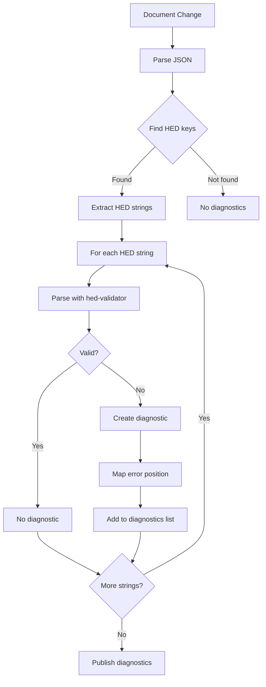
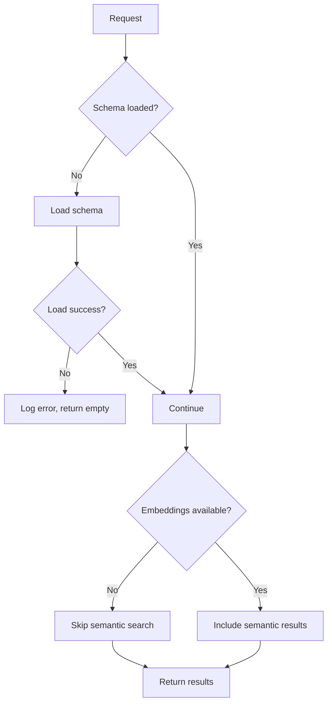

# HED-LSP Architecture

This document describes the overall architecture of the HED-LSP system.

## System Overview

HED-LSP follows the Language Server Protocol (LSP) architecture, separating the VS Code extension (client) from the language intelligence (server).



## Request Flow

When a user types in the editor, requests flow through the system:



## Component Architecture

### Server Components

The server is split into an engine and adapters. The engine (`server/src/engine/`) is pure: it has no language-server imports, and a boundary test enforces that. Adapters translate between the engine and an editor, a command line, or an HTTP client.
There are three: the language server, the `hed-suggest` command line tool, and the HTTP daemon in `server/src/daemon/`, which is described in [HTTP Daemon](./daemon.md).
The daemon may import its own modules, the engine facade `engine/index.ts`, and node built-ins, and nothing else; the boundary test enforces that too.



Engine log lines go to stderr by default, so the CLI JSON on stdout stays clean. The language server sends them to its console, one string per message. Under `--stdio` the client receives them as log messages; under IPC, info lines go to stdout and error lines go to stderr. A line can carry a detail beside its text, such as the message of an error, and each sink decides whether to print it: the default sink and the language server print `text: detail`, and the daemon's sink drops the detail, because the message can quote the request.

### Daemon Request Lifecycle

Every request to the daemon follows the same path.
Limits are checked in the order that is cheapest first, so a refused request costs the least work.



Two timers surround this path.
The request timer, `REQUEST_TIMEOUT_MS`, starts when the headers arrive and answers 503 `TIMEOUT` if the whole path, queue wait included, has not finished; the work stops at its next item.
The body timer, `BODY_TIMEOUT_MS`, starts at the same moment and answers 408 `REQUEST_TIMEOUT` if the body is not complete in time.
A body is input, not work: while a POST body arrives it holds one of its client's pending-body slots (`MAX_PENDING_BODIES_PER_CLIENT`) and no in-flight slot, so a slow sender cannot lock other clients out.
The in-flight slots, one for the client and one shared, are taken when the body is complete, or at once when there is none, and held until the work has stopped, so the caps count work that is still running after a timeout.
Any answer that is sent while the body is still arriving first arranges for the rest of it to be read and dropped, up to four times `MAX_BODY_BYTES` and for at most `BODY_TIMEOUT_MS` after the answer, after which the connection is closed.
The write of the answer has its own watchdog, `WRITE_STALL_MS`: the body goes out in pieces, each after the socket has drained, and a write that makes no progress for that long has its connection reset, so a client that stops reading cannot hold a connection until Node's socket timeout fires two to three periods later.
A second bound, `WRITE_TOTAL_MS`, ends a write that is still making progress but has not finished in that time, so a client that reads a little now and then cannot hold the connection either.
No charge is refunded on any of these exits.

### Data Flow for Validation



### Data Flow for Completion

```mermaid
flowchart TD
    A[Completion Request] --> B[Get cursor position]
    B --> C[Find HED context]
    C --> D{Trigger character?}

    D -->|/| E[Get parent tag]
    E --> F[Lookup children in schema]

    D -->|, or space| G[Check for partial text]
    G --> H{Has partial?}

    H -->|Yes| I[Prefix match + Semantic search]
    H -->|No| J[Top-level tags]

    D -->|(| K[Start new group]
    K --> J

    F --> L[Build completions]
    I --> L
    J --> L

    L --> M[Sort by relevance]
    M --> N[Return CompletionList]
```

## File Structure

```
hed-lsp/
├── client/                 # VS Code extension
│   ├── src/
│   │   └── extension.ts    # Extension entry point
│   ├── package.json        # Extension manifest
│   └── tsconfig.json
│
├── server/                 # Language server
│   ├── src/
│   │   ├── engine/         # Pure engine: no language-server imports
│   │   │   ├── index.ts    # Facade: validate, suggestions, schema access
│   │   │   ├── validation.ts # HED validation (pure)
│   │   │   ├── suggestionEngine.ts # Suggestion cascade
│   │   │   ├── schemaManager.ts # Schema loading
│   │   │   ├── embeddings.ts # Semantic search
│   │   │   └── log.ts      # Engine logging (stderr by default)
│   │   ├── server.ts       # LSP connection & routing
│   │   ├── daemon/         # HTTP adapter: v1 API, limits, entry point, load harness
│   │   │   ├── server.ts   # Routing, envelope, endpoints, limits
│   │   │   ├── config.ts   # HED_LSP_* settings
│   │   │   ├── limits.ts   # Buckets, client table, slots
│   │   │   ├── schemas.ts  # Schema allowlist and backoff
│   │   │   ├── semantic.ts # Semantic state, slot, queue
│   │   │   └── main.ts     # Entry point
│   │   ├── completion.ts   # Autocomplete logic (adapter)
│   │   ├── diagnostics.ts  # Validation to LSP diagnostics (adapter)
│   │   ├── hover.ts        # Hover information (adapter)
│   │   ├── documentParser.ts # JSON parsing
│   │   └── types.ts        # LSP types and the re-exported engine types
│   ├── data/
│   │   └── tag-embeddings.compact.json
│   ├── scripts/
│   │   └── generateEmbeddings.ts
│   ├── package.json
│   └── tsconfig.json
│
├── docs/                   # Documentation
├── Dockerfile              # Daemon image (linux/amd64)
├── scripts/
│   └── daemon-smoke.sh     # Smoke test for a running daemon or image
├── package.json            # Root workspace
└── tsconfig.json           # Root TypeScript config
```

## Key Design Decisions

### 1. Separate Client/Server

The LSP architecture allows the language intelligence to run in a separate process, improving VS Code responsiveness.

### 2. Schema Caching

Schemas are cached in memory after first load to avoid repeated network/disk access.

### 3. Pre-computed Embeddings

Tag embeddings are pre-computed and stored in JSON to avoid loading the ML model at runtime for most users.

### 4. Dual-Embedding Architecture

Semantic search uses both keyword anchors and direct tag matching to improve relevance. See [Semantic Search](./semantic-search.md) for details.

### 5. Debounced Validation

Validation is debounced (300ms) during typing to reduce CPU usage while still providing responsive feedback.

## Error Handling



The system is designed to degrade gracefully:
- If schema fails to load: validation and completion disabled
- If embeddings fail to load: semantic search disabled, prefix matching still works
- If embedding model fails: falls back to deterministic keyword index
