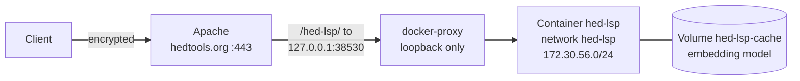

# Deploying the daemon on hedtools

This runbook puts the HED-LSP daemon on the hedtools host as a container under the path `/hed-lsp/` of `hedtools.org`, measures it, and keeps rollback cheap.
It covers the topology, each step with its approval gate and its rollback, the exact commands that need `sudo` for Apache, the measurement and its criteria, monitoring, and the privacy statement.
For what the daemon does and the settings it reads, see [HTTP Daemon](./daemon.md).

Hierarchical Event Descriptors (HED) is the annotation system the daemon validates and completes.
The Application Programming Interface (API) of the daemon, served over the Hypertext Transfer Protocol (HTTP), is version 1, and nothing here changes it.

Everything on the host is done by hand, one step at a time, at the approval gates below.
Nothing on the host or on GitHub changes until the step that changes it has been approved.
Steps that need `sudo` are run by the host owner, because `sudo` on the host asks for a password.

There are two milestones.

- **M1, public launch with semantic search off.**
  It needs the image on the host, the Apache route, a passing load run with semantic search off, and the owner-review gate.
- **M2, semantic search on.**
  It needs the two semantic defects fixed in a new image (issues #70 and #71), the model cache seeded, and the semantic gate measured after the virtual CPU (vCPU) increase.

## Topology



| Piece | Value |
|---|---|
| Public route | `https://hedtools.org/hed-lsp/`, a `<Location>` in the `:443` virtual host of hedtools.org only |
| Apache to container | `http://127.0.0.1:38530/`, published on the loopback address of the host and nowhere else |
| Container | `hed-lsp`, restart policy `unless-stopped`, started by `deploy/hedtools/deploy.sh` from an image ID |
| Network | `hed-lsp`, subnet 172.30.56.0/24, gateway 172.30.56.1 |
| Trusted proxy | `HED_LSP_TRUSTED_PROXIES=172.30.56.1`, the gateway, which is the address Apache's requests reach the container from |
| Model cache | volume `hed-lsp-cache`, mounted at `/home/node/.cache` |
| State | `~/hed-lsp-state/`: `hed-lsp.env` (the settings), `previous-image-id` (the last good image, for `deploy.sh --rollback`), `images/` (gzipped image tarballs), `results/` (measurements) |
| Repository clone | `~/hed-lsp`, which supplies the scripts and the harness corpus `server/eval/hed-examples-pairs.json` |
| Limits | `--cpus 0.5`, `--cpu-shares 512`, `--memory 1g` (semantic search off) or `3g` (on), equal `--memory-swap`, `--pids-limit 256` |

The files that make this deployment are in the repository.

| File | Purpose |
|---|---|
| `deploy/hedtools/deploy.sh` | Checks the settings with the image, creates the network and the volume, replaces the container, and rolls back with `--rollback`; `--dry-run` prints every step |
| `deploy/hedtools/hed-lsp.env.example` | Template of `~/hed-lsp-state/hed-lsp.env` |
| `deploy/hedtools/apache-hed-lsp.conf` | The Apache snippet for the route |
| `deploy/hedtools/check-client-key.sh` | The behavioral test of which address the daemon limits by |
| `deploy/hedtools/measure.sh` | The measurement sequences, with the neighbor probe beside the load |
| `deploy/hedtools/neighbor-probe.sh` | The do-no-harm probe of the other services on the host |
| `scripts/check-load-report.ts` | Judges a harness report against the criteria, run with Bun |
| `scripts/daemon-smoke.sh` | The smoke test of a running daemon |

## What was observed on the host

These are the results of a read-only inspection made on 2026-10-16, before this runbook was written.
Nothing was changed on the host.
The scripts do not re-check them, so look again when it matters.

- Ubuntu 22.04.5, kernel 6.8, Docker 28.1.1 with Compose v2.35.1, cgroup v2.
- One vCPU (Xeon Silver 4514Y) and 7.9 GiB of memory, 5.1 GiB of it available, with 6.3 GiB of swap of which 2.0 GiB was used but with almost no swap traffic.
  The load average was 0.2, but the central processing unit (CPU) pressure ("some") averaged 17.7% over 10 seconds even at idle.
  Memory pressure was 0.
- `/` had 47 GiB free.
  Docker images used 8.4 GB, of which 6.1 GB was reclaimable.
- `/etc/docker/daemon.json` is absent, so Docker logs use `json-file` without rotation for the other containers.
  There are no registry credentials on the host.
- The user `yahya` is in the `docker` group.
  `sudo` needs a password.
- Containers: `osa`, `osa-dev`, `hedit`, and `hedit-dev` (public `ghcr.io` images, `unless-stopped`, on the default bridge, published on 127.0.0.1 at ports 38528, 38529, 38427, and 38428, no resource limits, health checks present, all healthy) and `hedtools` and `hedtools_dev` (built locally, published on **0.0.0.0** at ports 33000 and 33004, no health check).
  Together they used about 0.9 GiB.
- Port 38530 and the subnet 172.30.56.0/24 were free.
- Apache 2.4.52 with the prefork module: `MaxRequestWorkers 150`, `Timeout 300`, `KeepAliveTimeout 5`, `RequestReadTimeout` 20 to 40 s for headers and 10 s at 500 B/s for the body.
  Enabled: proxy, proxy_http, headers, env, rewrite, reqtimeout, ssl, deflate, status.
  Not enabled: remoteip, ratelimit, http2.
- The hedtools.org `:443` virtual host has four bare `ProxyPass` lines (`/hed/`, `/hed_dev/`, `/hed-bot-api/`, `/hed-bot-dev-api/`), `ProxyPreserveHost On`, and `RequestHeader set X-Forwarded-For %{REMOTE_ADDR}s`.
  `/hed-lsp/` answered with an Apache 404.
- The access log uses the `combined` format and logrotate keeps about 14 days.
  No content delivery network or load balancer sits in front of Apache.
- `ghcr.io`, `huggingface.co`, and `raw.githubusercontent.com` were reachable from the host.
  `cdn-lfs.huggingface.co` did not connect.
- The `osa` container sees Apache's traffic as coming from 172.17.0.1, the gateway of the default bridge.
- Idle latency: `osa` `/health` 16 to 41 ms, `hedit` `/health` 6 to 9 ms, `hedtools` `/hed/` on loopback 7 to 15 ms, and `https://hedtools.org/hed/` from the host 40 to 48 ms.

### Not verified

- Whether `%{REMOTE_ADDR}s` gives the real client address in the existing virtual host.
  The route removes any client `X-Forwarded-For` header and the `proxy` mode of `check-client-key.sh` tests the result.
- That connections to the published port reach the container from the gateway 172.30.56.1 on the new network.
  On the host it is inferred from the bridge `docker0`, and `check-client-key.sh direct` observes it.
  On Docker Desktop for Mac it was observed to be the gateway.
- `--read-only` together with the cache volume on this host.
  It worked in a local run with semantic search off.
  If it fails, run `deploy.sh --no-read-only`.
- The path the model download takes, because `cdn-lfs.huggingface.co` did not connect, and the model revision is not pinned.
- Whether `ufw` or `fail2ban` treat the 429 and 403 answers in a special way, because their configuration needs `sudo` to read.
- Whether the firewall blocks ports 33000 and 33004, which listen on every address.
  That is outside this deployment and is reported to the host owner.
- Whether the project owner can change the visibility of the package on `ghcr.io`.
  Making it public cannot be undone.
- The speed of one core of the virtual machine and its swap behavior under semantic load.
- The `image` CI job has never run on GitHub, so the first draft pull request may fail and need fixes.
  It is skipped under `act`, so its change is validated only there.
- Whether the fix for #71 changes the latency of semantic search, which is why the semantic measurement follows it.
- What the daemon does when GitHub is unreachable at its start: it serves the bundled 8.4.0 under the name 8.5.0 until it restarts, and says so in `schemas.degraded`.

## Design decisions

| # | Decision | Why |
|---|---|---|
| A | The image reaches the host as the tarball that CI built and smoke-tested on a draft pull request from the epic branch into `main`, loaded with `docker load`. The image ID is its identity. | A manual publish from the epic branch would publish a public image that nobody has reviewed, a local build is not the tested artifact, and a build on the host uses the one vCPU. |
| B | No registry access on the host. After the first publish the package is made public. | A token on a host with seven accounts is a risk, and a public package cannot be made private again. |
| C | A plain `docker run` in `deploy.sh`, as `osa` and `hedit` do, with an image ID or digest and never a tag. No cron auto-update. | Compose adds a tool for one container, and a systemd unit needs `sudo` and differs from the host. |
| D | An Apache `<Location>` included from the `:443` virtual host only, in three stages: loopback only, testers only (`Require ip`), then public. | The final configuration is tested before it is public. |
| E | The trusted proxy is the pinned gateway of a dedicated network, verified three ways. | The default bridge `docker0` is shared by four containers. If the peer is not trusted, every client shares one rate key, which fails closed as 429 answers. |
| F | The resource caps above, and a do-no-harm probe of the neighbors during every load run. | With no cap a flood could hurt `osa`, `hedit`, and `hedtools` on one vCPU. |
| G | The harness measures what reaches the embedding model (97% of the evaluation queries at `top` 50, against 27% at `top` 10), runs semantic search off first and then on, and repeats everything after the vCPU increase. The verdict uses the post-increase numbers. | A 27% reach understates the cost of the model by a factor of about 3.6. |
| H | Semantic search is off at launch. It goes on only after #70 and #71 are fixed in a new image, the cache is seeded, the gate passes after the vCPU increase, and the owner approves. | Earlier it returns invalid HED tags and tags of the wrong schema. |
| I | The Docker health check for observability, an external check that matches `"status":"ok"`, rotated container logs, and the privacy statement below. | Health answers 200 for `degraded`, so a check of the status code alone misses a degraded daemon. |
| J | The ID of the last good image is recorded in `~/hed-lsp-state/previous-image-id`, tagged as `hed-lsp-daemon:previous`, and kept as a gzipped tarball in `~/hed-lsp-state/images/`. It is recorded only from a healthy container, so a second bad image never overwrites it. | A routine `docker image prune -a` would delete an unused rollback image, and a record made on every run would lose the good image to the second bad one. |

## Procedure

Each row touches the host or GitHub and needs an explicit approval before it runs.
Before each step, whoever runs it says what will run and waits for a yes.
Rows marked "owner" are run by the host owner because they need `sudo`.
The measurement sequences are called S0 (semantic search off) and S1 (semantic search on), and the [Measurement](#measurement) section has them.

| # | Step | Who | Expected | Rollback |
|---|---|---|---|---|
| 1 | File the defect issues and comment on #57 that #70 and #71 block M2 (done) | assistant | A link on #57 | Delete the comment |
| 2 | Merge the tooling pull request (5a) into the epic branch | assistant | The deploy files and the CI change are on the epic branch | Revert the commit |
| 3 | Open the draft pull request from the epic branch into `main` and request review | assistant | Continuous integration (CI) is green, the image tarball is an artifact, the job summary prints the image ID, review is requested | Close the pull request |
| 4 | Create the `ghcr-publish` environment (done) | owner | It exists | `gh api -X DELETE .../environments/ghcr-publish` |
| 5 | Ask for more vCPUs | owner | `nproc` above 1 | Not applicable |
| 6 | Clone the repository and prepare the state on the host | assistant | The directories exist | `rm -rf ~/hed-lsp ~/hed-lsp-state` |
| 7 | Load the image onto the host | assistant | The ID on the host equals the one in the CI summary | `docker rmi <id>` |
| 8 | Start the container, loopback only, semantic search off | assistant | `docker ps` shows it healthy, and `ss` shows 127.0.0.1:38530 only | `docker rm -f hed-lsp` |
| 9 | Smoke test and the check of the client key | assistant | The smoke test passes and the client key is verified | None needed |
| 10 | The semantic-off load runs, in a quiet window | assistant | The criteria pass and the neighbors are unharmed | Ctrl-C, or from another terminal `docker kill hed-lsp-load` |
| 11 | Apache Stage 1, testers only, and reload | owner | "Syntax OK", and the other routes still answer 200 | Restore the backup, `configtest`, reload (under 5 s) |
| 12 | External verification through Apache | assistant | No Apache HTML error where the daemon should have answered (a body up to 2 MiB gets the daemon's JSON 413, and a body above 2 MiB gets Apache's HTML 502), and the limiter keys by the real address | As in step 11 |
| 13 | Owner-review gate, then Apache Stage 2 (public) | owner | The public route is live; not before the reviewer has had the chance to comment, unless the owner says otherwise | Restore `Require ip` and reload |
| 14 | Seed the model cache (M2) | assistant | `semantic.state` is `ready` and the model checksum is recorded | See the step |
| 15 | Enable semantic search (M2) | owner and assistant | The semantic gate passes and health shows `ready` | `HED_LSP_SEMANTIC=0` and run `deploy.sh` again |
| 16 | Merge the epic into `main`, approve the publish run, make the package public | owner | A digest in the job summary and an anonymous pull works | `deploy.sh --rollback`; making the package public cannot be reverted |

### Steps 6 and 7: the repository and the image

Step 6, after 5a is merged:

```bash
git clone --branch feature/issue-52-epic-hed-engine https://github.com/hed-standard/hed-lsp.git ~/hed-lsp
mkdir -p ~/hed-lsp-state/{images,results}
```

Step 7, from a workstation that has the CI artifact.
The tarball is stored on the host as a gzipped file, which is also the rollback copy of the image, and loaded from there:

```bash
gh run download <run id> --repo hed-standard/hed-lsp -n hed-lsp-daemon-image
gzip -1 < hed-lsp-daemon.tar > hed-lsp-daemon-<first 12 digits of the ID>.tar.gz
scp -J hallu hed-lsp-daemon-<first 12 digits of the ID>.tar.gz hedtools:hed-lsp-state/images/
ssh -J hallu hedtools 'gunzip < ~/hed-lsp-state/images/hed-lsp-daemon-<first 12 digits of the ID>.tar.gz | docker load'
ssh -J hallu hedtools "docker image inspect --format '{{.Id}}' hed-lsp-daemon:ci"
```

The last line must print the image ID that the CI job summary printed.
If it does not, stop.
Keep the last two tarballs in `~/hed-lsp-state/images/` (about 390 MB each) and remove older ones.

### Steps 8 and 9: start and check

```bash
cp ~/hed-lsp/deploy/hedtools/hed-lsp.env.example ~/hed-lsp-state/hed-lsp.env
chmod 600 ~/hed-lsp-state/hed-lsp.env
# In that file, set HED_LSP_IMAGE_ID=sha256:<the image ID>
~/hed-lsp/deploy/hedtools/deploy.sh --dry-run sha256:<the image ID>
~/hed-lsp/deploy/hedtools/deploy.sh sha256:<the image ID>
docker ps --filter name=hed-lsp
ss -ltn | grep 38530
```

`deploy.sh` takes an image ID or a digest, never a tag, and checks the settings file without printing a value.
The dry run prints every step, including the settings check and the rollback command, calls no Docker, and writes no file.

A real run goes in this order:

1. **The settings check.**
   A throwaway container of the new image loads the daemon's own configuration code with the same settings file and the same `HED_LSP_TRUSTED_PROXIES` override.
   A value that the daemon would refuse at start, such as `HED_LSP_SEMANTIC=1 # on`, `HED_LSP_SEMANTIC="1"` (Docker does not remove quotes), or `HED_LSP_MAX_IN_FLIGHT=eight`, stops the script here, before anything is stopped.
   The message names the variable and the rule and never the value, so the error is not a place where a setting leaks.
   Without this check, such a value became a crash loop under `unless-stopped` after the old container was already gone.
2. **The record of the last good image.**
   If `hed-lsp` is running, is healthy, and runs another image, its image ID is written to `~/hed-lsp-state/previous-image-id` and tagged `hed-lsp-daemon:previous`.
   An unhealthy or missing container leaves the record as it is, so a second bad image never overwrites the good one.
3. **The replacement.**
   The old container is stopped and removed, and the new one is started.
   The route answers 503 for 10 to 20 seconds.
4. **The poll.**
   Every 2 seconds the script reads whether the container runs, whether it is restarting, its restart count, and its health.
   It fails at once on a restart (Docker reports `Running` as true during a crash loop, so the restart flag and the count are what show it), on a stop, and on `unhealthy`, and it fails after 180 seconds.
   Every failure prints the state of the container and the rollback command, exits non-zero, and removes nothing, so the failed container stays for `docker logs hed-lsp`.
   Read the log of a failed daemon with care: it names the setting that was refused, with its value.

The smoke test runs in a throwaway container of the same image, because the host has no Node.js.
Set `HED_LSP_EXPECTED_COMMIT` to the short commit of the pull request head, which is also the `commit` of the health answer:

```bash
docker run --rm --network host --entrypoint bash \
  -v ~/hed-lsp/scripts/daemon-smoke.sh:/tmp/daemon-smoke.sh:ro \
  -e HED_LSP_DAEMON_URL=http://127.0.0.1:38530 -e HED_LSP_EXPECTED_COMMIT=<short commit> \
  sha256:<the image ID> /tmp/daemon-smoke.sh

~/hed-lsp/deploy/hedtools/check-client-key.sh direct
```

The client key is verified three ways, and `check-client-key.sh direct` prints what it expects before what it got:

1. `docker network inspect hed-lsp` shows the gateway 172.30.56.1.
2. While a connection from the host is held open, `docker exec hed-lsp cat /proc/net/tcp` shows the remote address in hexadecimal, and it decodes to the gateway.
3. Requests of 100 strings with `X-Forwarded-For: 203.0.113.1` (100 units each against the burst of 1000) are sent until the first 429, at most 40, and then three requests in a row with `203.0.113.2` all pass.
   The count before the 429 is not fixed, because the bucket refills 100 units a second: about 10 on loopback, and 13 when every answer takes 170 ms longer.
   The `proxy` mode likewise looks at three requests in a row from the second address, which must include a 429, and `other` needs all three to pass; one request would depend on how much the bucket refilled in between.

Run it again after any Docker or kernel upgrade.
Any local user of the host can spoof a key through loopback, because the loopback connection comes through the trusted gateway.
That is accepted and documented.

### Step 10: the load runs

Tell the owners of `osa`, `hedit`, and `hedtools` first, and use a quiet window.
Rehearse once with short steps, which are not results (judge their files with `check-load-report.ts --rehearsal`):

```bash
~/hed-lsp/deploy/hedtools/measure.sh --rehearsal 10 s0-c4
~/hed-lsp/deploy/hedtools/measure.sh s0
```

`measure.sh` refuses to run unless `HED_LSP_IMAGE_ID` in the settings file is the image of the running container, so a measurement is always of the image that was reviewed.
The harness runs in a throwaway container of that image with the corpus mounted:

```bash
docker run --rm --init --name hed-lsp-load --network host --cpus 0.2 --memory 256m \
  -v ~/hed-lsp/server/eval:/corpus:ro --entrypoint node <image ID> \
  out/daemon/loadTest.js --url http://127.0.0.1:38530 --corpus /corpus/hed-examples-pairs.json ...
```

Its report goes to standard output, because the cache volume and the bind mounts belong to different users, and `measure.sh` writes it to `~/hed-lsp-state/results/`.
`--clients 64` is honored because the daemon trusts the path from the harness.
Ctrl-C ends a run, and so do `kill` (SIGTERM), a hangup, and any other exit of `measure.sh`: it then stops the neighbor probe and the memory sampler and runs `docker kill hed-lsp-load`, so nothing is left running.
The harness container also starts with `--init`, so that it passes Ctrl-C and `docker stop` on to the harness.
The emergency stop, from another terminal, is `docker kill hed-lsp-load`, which ends the harness at once; the probe sees the harness end and `measure.sh` stops it.
Only `kill -9` of `measure.sh` cannot be caught: then the harness ends at the duration of its step, and the probe and the sampler end by themselves 5 minutes after the step would have ended.

Rehearse the stop before the first real run: start `measure.sh --rehearsal 30 s0-c4`, press Ctrl-C after a few seconds, and check that nothing is left with `docker ps --filter name=hed-lsp-load` and `pgrep -fl neighbor-probe`, which must print nothing.

Copy the results to a machine with Bun and judge them:

```bash
scp -J hallu 'hedtools:hed-lsp-state/results/*' results/
bun scripts/check-load-report.ts --profile s0 results/<time>-s0-c4.json
bun scripts/check-load-report.ts --profile s0-overload results/<time>-s0-overload.json
```

The gate is the run at concurrency 4.
The runs at concurrency 1 and 8 are recorded, and only their lines about 5xx and 429 answers must pass.

### Steps 11 to 13: Apache

The commands for the owner are in the next section, and the checks of step 12 are here.
None of these needs `sudo`.
Run them from a machine whose address is in the `Require ip` line.
The `check-client-key.sh` commands need a clone of the repository there too, and the last pair of commands runs on the host.
`BASE` is `https://hedtools.org/hed-lsp`.

```bash
BASE=https://hedtools.org/hed-lsp
curl -sS "$BASE/v1/health"                                   # status ok, and the commit of the pull request head
curl -sS -X POST "$BASE/v1/validate" -H 'Content-Type: application/json' \
  -d '{"strings":["Sensory-event, Red"],"schema":"8.4.0"}'   # valid

# A small chunked body, which Apache reads at once and sends with a Content-Length: 200.
echo '{"strings":["Red"]}' | curl -sS -o /dev/null -w '%{http_code}\n' -X POST "$BASE/v1/validate" \
  -H 'Content-Type: application/json' -H 'Transfer-Encoding: chunked' --data-binary @-

# A chunked body of 1 MiB, which Apache passes on as chunked: the daemon's JSON 411 (LENGTH_REQUIRED), and nothing is spooled to disk.
head -c 1048576 /dev/zero | curl -sS -w '\n%{http_code}\n' -X POST "$BASE/v1/validate" \
  -H 'Content-Type: application/json' -H 'Transfer-Encoding: chunked' --data-binary @-

# A body over the daemon's limit of 524288 bytes: the daemon's JSON 413 (PAYLOAD_TOO_LARGE) up to 2 MiB, and Apache's HTML 502 above it.
head -c 600000 /dev/zero | curl -sS -w '\n%{http_code}\n' -X POST "$BASE/v1/validate" -H 'Content-Type: application/json' --data-binary @-
head -c 3000000 /dev/zero | curl -sS -o /dev/null -w '%{http_code}\n' -X POST "$BASE/v1/validate" -H 'Content-Type: application/json' --data-binary @-

# The cross-origin preflight (Cross-Origin Resource Sharing, CORS): 204 with Access-Control-Allow-Origin: *.
curl -sS -i -X OPTIONS -H 'Origin: https://example.org' -H 'Access-Control-Request-Method: POST' "$BASE/v1/validate"
```

The smoke script cannot run from outside because one of its checks reads the data directory of the image, so the daemon's other answers are checked here by hand.
The 600000-byte body must get the daemon's JSON 413, and the 3000000-byte body gets Apache's HTML 502, as the section [Oversize request bodies](#oversize-request-bodies) explains.
The small chunked body must get 200 and the 1 MiB chunked body the JSON 411, as the same section explains.

Then the limiter, from two tester addresses, the first with `--hold` and the second inside the time it holds:

```bash
deploy/hedtools/check-client-key.sh proxy --url "$BASE" --hold 40     # from tester 1
deploy/hedtools/check-client-key.sh other --url "$BASE"               # from tester 2, within 40 seconds
```

`proxy` shows that a spoofed `X-Forwarded-For` has no effect, because Apache removes it, and `other` shows that a second real address is not limited by the first.
A 429 answer carries `Retry-After`; the daemon's own tests cover that, and `curl -i` on a limited request shows it.

The daemon-stopped path and the recovery, from the host:

```bash
docker stop hed-lsp          # Apache answers 503 (an HTML page), and the other routes still answer
docker start hed-lsp         # the route recovers within the 10 to 20 seconds of start-up, with no Apache reload
```

`retry=0` in the snippet is what makes the recovery need no reload.

### Step 14: seed the model cache (M2)

The image never downloads the model, so the cache volume is seeded once by a container that may.
It is the run command of `deploy.sh` with another name, another loopback port, no restart policy, `HED_LSP_SEMANTIC=1`, `HED_LSP_MODEL_DOWNLOAD=1`, and 3 GiB:

```bash
docker run -d --name hed-lsp-seed --network hed-lsp \
  -p 127.0.0.1:38531:38530 --stop-timeout 15 \
  --cpus 0.5 --cpu-shares 512 --memory 3g --memory-swap 3g --pids-limit 256 \
  --read-only --tmpfs /tmp --cap-drop ALL --security-opt no-new-privileges \
  -v hed-lsp-cache:/home/node/.cache \
  --log-opt max-size=20m --log-opt max-file=5 \
  --env-file ~/hed-lsp-state/hed-lsp.env -e HED_LSP_TRUSTED_PROXIES=172.30.56.1 \
  -e HED_LSP_SEMANTIC=1 -e HED_LSP_MODEL_DOWNLOAD=1 \
  sha256:<the image ID>

until [ "$(curl -s http://127.0.0.1:38531/v1/health | jq -r .semantic.state)" = ready ]; do sleep 10; done
```

Poll until `semantic.state` is `ready`; a state of `unavailable` means the download or the load failed, and `docker logs hed-lsp-seed` says why.
Then stop it, record the checksum of the model file, and remove it:

```bash
docker stop hed-lsp-seed
docker run --rm -v hed-lsp-cache:/cache:ro --entrypoint sh sha256:<the image ID> \
  -c 'find /cache -type f -name "*.onnx*" -exec sha256sum {} +'
docker rm hed-lsp-seed
```

The Secure Hash Algorithm 256 (SHA-256) checksums go into the results of the measurement, because the model revision is not pinned.
To throw the cache away, stop `hed-lsp`, remove the volume with `docker volume rm hed-lsp-cache`, and run `deploy.sh` again, which creates it empty.

### Step 15: semantic search on (M2)

```bash
# In ~/hed-lsp-state/hed-lsp.env: HED_LSP_SEMANTIC=1, and after a vCPU increase HED_LSP_ONNX_THREADS=<the whole number of CPUs given to the container>
~/hed-lsp/deploy/hedtools/deploy.sh --cpus <half the processors> sha256:<the image ID>
```

With `HED_LSP_SEMANTIC=1` in the file, `deploy.sh` gives the container 3 GiB of memory by itself.
The container is recreated, with 10 to 20 seconds of 503 `STARTING`, and semantic search is `loading` until the model is in memory.
Then run `measure.sh s1`.

After the vCPU increase, record `nproc`, give the container `--cpus` of half the processors, set `HED_LSP_ONNX_THREADS` to that number rounded down, and repeat S0 at concurrency 4 and 8 and all of S1.
A run before the increase is informational, and the verdict uses the numbers after it.

### Step 16: publish

After the epic is merged into `main`, the `publish-image` job waits for approval in the `ghcr-publish` environment, and then prints the digest of the image it pushed.
Deploy that digest, which `deploy.sh` pulls when it is not on the host:

```bash
~/hed-lsp/deploy/hedtools/deploy.sh ghcr.io/hed-standard/hed-lsp-daemon@sha256:<digest>
```

Making the package public is a step on the package settings page of GitHub, and it cannot be undone.

## Apache: the commands to run with sudo

Apache is changed in three stages.
Stage 1 is for the testers, Stage 2 is public, and the rollback restores the configuration from before.
The snippet is `deploy/hedtools/apache-hed-lsp.conf`, and it is included from the hedtools.org `:443` virtual host only.

The snippet has no `disablereuse=On`, no `LimitRequestBody`, and no `proxy-sendcl`, for the reasons measured in [Oversize request bodies](#oversize-request-bodies), so nothing is left to decide before Stage 1.

### Stage 1: testers only

Check first that the modules are there, then follow the five steps of the plan.

```bash
# 0. The modules the route needs (authz_core and authz_host come with Apache by default).
sudo apachectl -M 2>/dev/null | grep -E 'proxy_module|proxy_http_module|headers_module|authz_core_module|authz_host_module'

# 1. A clean baseline.
sudo apachectl configtest

# 2. Back up the virtual host file. 'sudo apachectl -S' names the file and line of the hedtools.org :443 virtual host.
#    That name may be a symbolic link (a2ensite makes one), and 'cp -a' copies a link as a link, so the backup
#    would point at the live file. Resolve it first, and use "$VHOST" in every command below and in the rollback.
sudo apachectl -S 2>&1 | grep -A2 'hedtools.org'
VHOST=$(readlink -f <virtual host file>)
ls -l "$VHOST"                      # a regular file, not a link
sudo cp -a "$VHOST" "$VHOST.bak-$(date +%F)"

# 3. Install the snippet with the tester addresses in place of the placeholders, and add one Include line to the :443 virtual host only.
#    The delimiter of sed is |, so that an address with a prefix length, such as 203.0.113.0/24, works.
sudo install -d -m 755 /etc/apache2/snippets
sed 's|<tester-1>|<address 1>|; s|<tester-2>|<address 2>|' ~yahya/hed-lsp/deploy/hedtools/apache-hed-lsp.conf \
  | sudo tee /etc/apache2/snippets/hed-lsp.conf > /dev/null
sudoedit "$VHOST"                   # add: Include /etc/apache2/snippets/hed-lsp.conf

# 4. Check, then reload gracefully.
sudo apachectl configtest           # Syntax OK
sudo systemctl reload apache2

# 5. The other routes must answer as before.
curl -sS -o /dev/null -w '%{http_code}\n' https://hedtools.org/hed/
curl -sS -o /dev/null -w '%{http_code}\n' https://hedtools.org/osa/health
curl -sS -o /dev/null -w '%{http_code}\n' https://hedtools.org/hedit/health
```

`configtest` does not notice a missing `proxy_http` module, so step 0 matters.
An unedited copy of the snippet fails `configtest`, because `<tester-1>` is not an address.

### Stage 2: public

Not before the reviewer has had the chance to comment, or the owner says otherwise.

```bash
sudoedit /etc/apache2/snippets/hed-lsp.conf    # change the Require line to: Require all granted
sudo apachectl configtest
sudo systemctl reload apache2
```

### Rollback of the route

Restore the backup of the virtual host file, or comment out the `Include` line, then check and reload.
`VHOST` is the real file that Stage 1 backed up and edited.
In a new shell, resolve it again, from the file named by `sudo apachectl -S`:

```bash
VHOST=$(readlink -f <virtual host file>)
sudo cp -a "$VHOST.bak-<date of the backup>" "$VHOST"    # the restore; or: sudoedit "$VHOST", and comment out the Include line
sudo apachectl configtest
sudo systemctl reload apache2
```

Requests to `/hed-lsp/` then get a 404.
Undoing Stage 2 alone is putting the `Require ip` line back and reloading.

### What each line of the snippet does

- `127.0.0.1` and not `localhost`, because `localhost` may try `::1` first and docker-proxy listens on IPv4 only.
- `timeout=40` is an idle input and output timeout of Apache.
  The daemon's deadline of 30 seconds plus a margin of 5 should fire first, so a client gets the JavaScript Object Notation (JSON) error `TIMEOUT` and not an HTML 502 or 504.
- `retry=0` stops Apache from remembering a backend failure for 60 seconds, so a restart of the container needs no reload.
- `ttl=30` closes an idle backend connection of Apache after 30 seconds, below the daemon's keep-alive of 65 seconds, so Apache drops it before the daemon does.
  Each prefork worker keeps at most one, 150 at most, under the daemon's cap `MAX_CONNECTIONS` of 256.
- There is no `disablereuse=On`, because an oversize body then gets Apache's HTML 502 and not the daemon's JSON 413 (see [Oversize request bodies](#oversize-request-bodies)).
- There is no `LimitRequestBody`, because it did not stop a proxied body in the test, so the daemon's limit of 524288 bytes is the only limit.
- There is no `SetEnv proxy-sendcl 1`, because it makes Apache spool every chunked client body to a temporary file with no bound.
  A chunked POST of 200 MiB grew a file in Apache's temporary directory to 193 MiB, at the rate of the client.
  Without it, chunked bodies are not spooled, and a chunked client gets the answers in [Chunked request bodies](#chunked-request-bodies).
- `RequestHeader unset X-Forwarded-For` removes any client value and the virtual host's `set`.
  mod_proxy then appends the real connection address as the only entry, which is what the daemon's rightmost-entry rule needs.
  `mod_remoteip` is not needed, because nothing sits in front of Apache.
- There is no compression, because of the one vCPU, and the global `RequestReadTimeout` already agrees with the daemon's body deadline of 10 seconds.

## Oversize request bodies

This section records what was measured on 2026-10-16, and it replaces what the plan assumed.
The measurements ran on a local machine with Apache 2.4.52, the version on the host, in front of the image built from the Phase 5 branch, with `curl` as the client.
The rate limits of the daemon were raised, so the limiter took no part.
Each size was sent 10 times.

The daemon refuses a body over 524288 bytes by its `Content-Length`, before it reads the body, and answers with the JSON error `PAYLOAD_TOO_LARGE`.
It then reads and drops up to four times its limit, 2097152 bytes (2 MiB), and closes the connection after that.

| Body in bytes | With `disablereuse=On` | The snippet (no `disablereuse`, `ttl=30`) |
|---|---|---|
| 600000 | Apache's HTML 502 in 6 of 10 (the JSON 413 in 4) | the daemon's JSON 413 in 10 of 10 |
| 1000000 | Apache's HTML 502 in 9 of 10 | the daemon's JSON 413 in 10 of 10 |
| 2000000 | Apache's HTML 502 in 10 of 10 | the daemon's JSON 413 in 10 of 10 |
| 3000000 | not measured | Apache's HTML 502 in 10 of 10 |

- **Bodies up to 2 MiB get the daemon's JSON 413, and the 600000-byte check of the smoke test passes through Apache.**
  The check was run on Apache 2.4.52 locally (10 of 10 above), not yet on the host.
- **Bodies beyond 2 MiB get Apache's HTML 502.**
  This is expected: the daemon closes the connection after its bounded discard of 2097152 bytes, while Apache is still sending.
- **`disablereuse=On` causes the 502 for the smaller bodies.**
  The daemon closes the connection after its JSON 413 while Apache is still sending the body, and Apache's error log shows `pass request body failed ... Broken pipe`.
  With the connection kept alive to the backend, the daemon drops the rest of the body first and Apache reads the 413.
- **`LimitRequestBody` does not limit the proxied body.**
  With `LimitRequestBody 1048576`, a body of 2000017 bytes reached the daemon.
  The daemon's limit is the only limit on the size of a body.
- **A client that sends `Connection: close` with a large unread body can see a connection reset instead of the answer.**
  This is the first item of "Known limits" in [HTTP Daemon](./daemon.md).
- **Reused backend connections are safe.**
  A burst of 30 small validate requests through one Apache all got 200.
  Without `disablereuse=On`, each prefork worker that has served the route can hold one idle backend connection, 150 at most against the 256 connections the daemon accepts, and `ttl=30` closes it before the daemon's keep-alive of 65 seconds.

### Chunked request bodies

The daemon refuses a POST without a `Content-Length` with the JSON error `LENGTH_REQUIRED` (411), so a chunked body only works if Apache turns it into a body with a length.
`SetEnv proxy-sendcl 1` did that by spooling the whole body to a temporary file of Apache, which has no bound: `LimitRequestBody` is not applied to a proxied body, as above.
A chunked POST of 200 MiB, sent at 25 MiB a second, grew a file in the temporary directory of the Apache container to 193 MiB and then got Apache's HTML 502.
The snippet therefore leaves it out.

These are the answers to a chunked POST through the snippet as it ships, with the temporary directory of Apache watched during the 200 MiB request.
They were measured with Apache 2.4.52 in a container, and the daemon running from the compiled output of this branch on the same machine (Node.js 26, not its container), reached through `host.docker.internal`.

| Chunked body | Answer | Why |
|---|---|---|
| 4096 to 16300 bytes, every trial (5 trials up to 12288 bytes, 3 above) | The daemon sees a `Content-Length` and answers as for any body: 200 for a valid request | Apache reads the whole body in its first read, which holds up to 16 KiB, and sends it with a length |
| 16370 to 2200000 bytes, every trial (3 to 5 trials each; 1 MiB is the case of step 12) | The daemon's JSON 411 `LENGTH_REQUIRED` | Apache passes the body on as chunked, and the daemon refuses it before it reads it |
| 3000000, 5000000, and 10000000 bytes, 5 of 5 each, and 200 MiB, 2 of 2 | Apache's HTML 502 | The daemon closes the connection after its bounded discard of 2097152 bytes, as for a body with a length |

- **The temporary directory did not grow.**
  During the 200 MiB request it held 4 KiB, which is the directory itself, against 193 MiB with `proxy-sendcl`.
- **Apache reads the whole chunked body before it answers 502.**
  The 200 MiB request took 8.0 seconds at 25 MiB a second, so a worker stays busy for as long as the client keeps sending, but it spools nothing.
  The `RequestReadTimeout` of the host (10 seconds for the body, at a rate of at least 500 bytes a second) ends only a slow sender.
- **A chunked client therefore works only for bodies of up to about 16 KiB.**
  A client of the daemon should send a `Content-Length`, as `fetch` does for a string body.

Not tested: Apache 2.4.69, and the path through docker-proxy on the host.
The checks of step 12 are run on the host.

## Measurement

The harness runs on the host against loopback, in a throwaway container of the deployed image, with the corpus mounted (step 10).
A second run from outside, through Apache, tests the route and the limits, not the capacity, because every request there shares one real key.
Its acceptance is no HTML 502 or 504 where the daemon should have answered, no unknown error codes, and `Retry-After` on every 429.

The sequences, which `measure.sh` runs:

| Step | Run | Profile of `check-load-report.ts` |
|---|---|---|
| `s0-c1`, `s0-c4`, `s0-c8` | Semantic search off, concurrency 1, 4, 8, 60 s each, mix `suggest=65,validate=35`, 64 clients | `s0` (the gate is concurrency 4) |
| `s0-overload` | Concurrency 12, 60 s: at least one `OVERLOADED` 503 answer with a `Retry-After`, no other 5xx or rejection, and recovery in under 5 s | `s0-overload` |
| `s1-mixed` | Semantic search on, 300 s at concurrency 4, mix `suggest=60,validate=30,semantic=10`, `--semantic-top 50` | `s1-mixed` |
| `s1-capacity` | 120 s of semantic requests only, `--semantic-top 50`, with the reach check, for the capacity C | `s1-capacity` |
| `s1-realistic` | 120 s of the mixed requests with `--semantic-top 10 --semantic-batch 10` | `s1-realistic` |
| `s1-soak` | 30 minutes at concurrency 1 | `s1-soak` |

The plan names no duration or concurrency for `s1-capacity` and `s1-realistic`, so the values in the table are this runbook's choice.

### Criteria

p95 and p99 are the 95th and 99th percentiles of the latency, by the nearest-rank method, over the answers with a 2xx status.

| Measure | Criterion |
|---|---|
| Semantic latency (`s1-mixed`) | p95 at most 500 ms, p99 at most 1 s |
| Non-semantic latency in the same run | p95 at most 100 ms, p99 at most 300 ms, for suggest and validate each |
| S0 at concurrency 4 | The same non-semantic bounds, 0 5xx, 0 429 |
| 5xx other than `SEMANTIC_BUSY` | 0 |
| `SEMANTIC_BUSY` | At most 1% of the semantic requests |
| 429 in the runs with 64 clients | 0 |
| Reach (`s1-capacity`) | At least 95% |
| Container memory | S0 peak at most 600 MiB, S1 peak at most 3 GiB, no out-of-memory (OOM) kill, restart count 0 |
| Soak | Memory drift at most 10% between minute 5 and the end |
| Host available memory | At least 1.5 GiB throughout |
| Neighbors | The probe within its thresholds, and Docker health stays healthy |
| Semantic correctness | #70 and #71 fixed, which a report cannot show |

`check-load-report.ts` exits 0 when every criterion passes, 1 when one fails, and 2 for a file it cannot read.
A criterion whose data is missing fails, and `--no-host` skips the ones that need the host file.
Every 429 and 503 answer must carry an integer `Retry-After` of at least 1 second, and a reach check that left a query without an answer fails.
The `s0-overload` run fails when it had no `OVERLOADED` answer, because then the daemon was never overloaded.
The files of a rehearsal (`measure.sh --rehearsal`) are practice and not results: the host file says so, and the checker fails them unless `--rehearsal` is given.
With `--rehearsal` it judges them as practice and labels its output "a rehearsal, not a result", and it fails the host file of a real run.

### The do-no-harm probe

During every run, `neighbor-probe.sh` asks `osa` `/health`, `hedit` `/health`, `hedtools` `/hed/` on loopback, and `https://hedtools.org/hed/` for an answer every 2 seconds, and reads the memory and swap counters of the host.
Every fifth round it reads the Docker state of the containers that were running at the start.

It aborts at once, kills the harness container, and exits 1 on any of these:

- a non-200 answer,
- a probe that takes over 1 second,
- host memory available under 1.0 GiB,
- sustained swap-in, taken here as an average of 50 pages a second or more over the last 5 rounds,
- a container that stopped, restarted, was killed for lack of memory, or reports unhealthy.

It passes if the loopback probes keep p95 at or below 150 ms, the Apache probe keeps p95 at or below 300 ms, and all Docker health stays healthy.
A neighbor that restarts for its own reasons, such as an automatic update of its image, also stops the run; run again.

The probe kills only a container whose name starts with `hed-lsp-` (`measure.sh` names `hed-lsp-load`), and it refuses any other name at its start, so it can never be told to kill `hed-lsp` itself or a container of another service.

### Recalibration

Recalibration goes through the settings file and not the code defaults, so the measured image stays the launch image.

- The semantic rate for each client is at most 0.1 of the capacity C.
- The semantic queue q is chosen so that q times 20 divided by C is at most 15 s.
- The general rate for each client is at most 10% of the measured non-semantic capacity.
- The cap on requests in flight comes from the p99 at the target concurrency.

## Monitoring and logs

- The Docker `HEALTHCHECK` is for observation only.
  Plain `docker run` never restarts an unhealthy container, and a watchdog is a deliberate non-goal for now.
  `docker ps` shows the health, and `docker inspect --format '{{json .State.Health}}' hed-lsp` shows the last probes.
- The external uptime check matches `"status":"ok"`, because health answers 200 for `degraded`:

  ```bash
  curl -fsS https://hedtools.org/hed-lsp/v1/health | grep -q '"status":"ok"'
  ```

  Until an external service does this, run it by hand.
  After the merge, a scheduled GitHub Actions check is recommended.
- The container logs rotate through `--log-opt` (5 files of 20 MB), and Apache's logs rotate through the existing logrotate.
  `docker logs --since 10m hed-lsp` shows one JSON line for each request.
- `docker stats --no-stream hed-lsp` shows the memory and the CPU of the container.

## The privacy statement

This is the text for this runbook and, later, for the notice in the client.

> The daemon logs no request text and no Internet Protocol (IP) address.
> It keeps IP addresses only in memory, for the rate limiter, for up to 10 minutes after the last request.
> Apache keeps its standard `combined` access log for about 14 days: client IP address, time, method, path, status, bytes, referer, and user agent.
> Request bodies are never logged.

## Rollback

| Target | Steps | Time |
|---|---|---|
| Emergency kill (no `sudo`) | `docker stop hed-lsp`. Apache answers 503, the clients fall back to local, and it stays stopped across reboots | 1 to 10 s |
| Image | `deploy.sh --rollback`, which starts the image recorded in `~/hed-lsp-state/previous-image-id` through the same steps (the settings check, the replacement, the poll). It refuses when nothing is recorded; then run `deploy.sh <image ID or digest>` with an image that is known to work. The cache volume is untouched. The image is also tagged `hed-lsp-daemon:previous`, and a tag is never accepted as an argument | 15 to 30 s |
| Flag | `HED_LSP_SEMANTIC=0` in the settings file, then `deploy.sh <the image ID that runs>` again | 10 to 20 s |
| Route | Restore the virtual host backup over `"$VHOST"` (the resolved real file, see [Rollback of the route](#rollback-of-the-route)), or comment out the `Include` line there, then `sudo apachectl configtest` and `sudo systemctl reload apache2`. Requests then get a 404 | Under 5 s |
| Full removal | `docker rm -f hed-lsp`, `docker network rm hed-lsp`, `docker volume rm hed-lsp-cache`, remove the snippet and the `Include` line, reload | About 1 minute |

The image of the record stays on the host, tagged, with a gzipped tarball of it in `~/hed-lsp-state/images/`, and the last two are kept.
`deploy.sh --rollback` takes the same options as a deploy (`--cpus`, `--memory`, `--no-read-only`), and a failed deploy prints the command with the options of that run.
A rollback that is started from a healthy container records that container's image in turn, so a second `--rollback` goes forward again.
Rehearse a rollback before Stage 2.

## Gates before Stage 2

1. The tooling pull request is merged, and the image ID on the host matches the CI summary.
2. The local checks pass: `bun run check`, `bun run spellcheck`, `bun run compile`, `bun run test`.
3. The owner-review gate is satisfied, or the owner waives it.
4. The loopback smoke test passes and the peer address is verified.
5. S0 passes with the neighbors unharmed.
6. Stage 1 is verified from two external addresses: the checks of step 12 (a small chunked body gets 200, a 1 MiB chunked body gets the daemon's JSON 411, a 600000-byte body gets the daemon's JSON 413, and a 3000000-byte body gets Apache's HTML 502), the CORS preflight, the daemon-stopped path, and the recovery.
7. A rollback has been rehearsed.
8. Monitoring and the privacy text are in place.
9. The owner approves.
