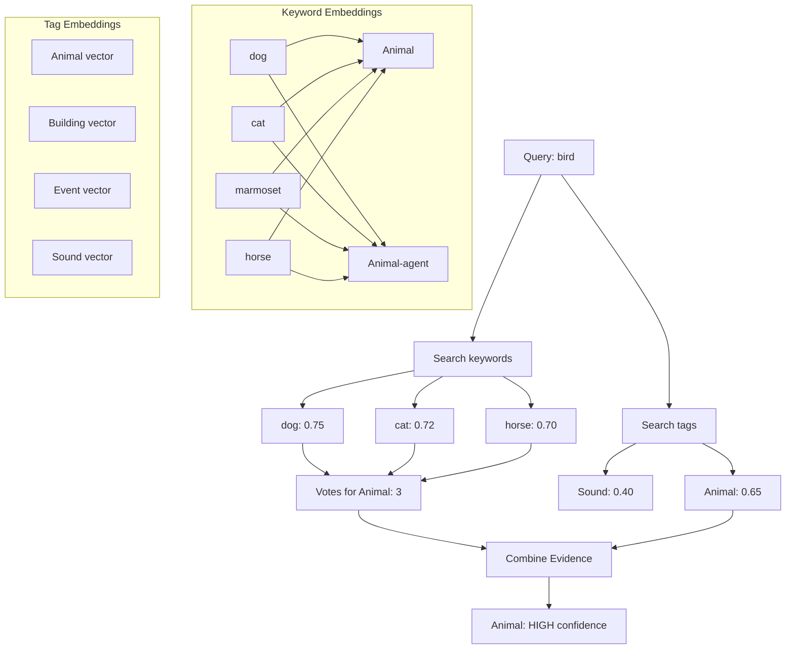
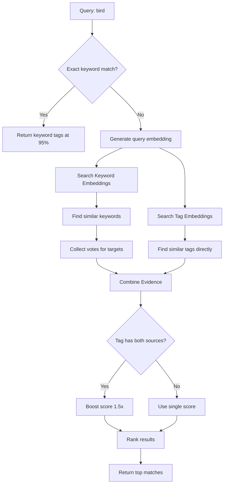
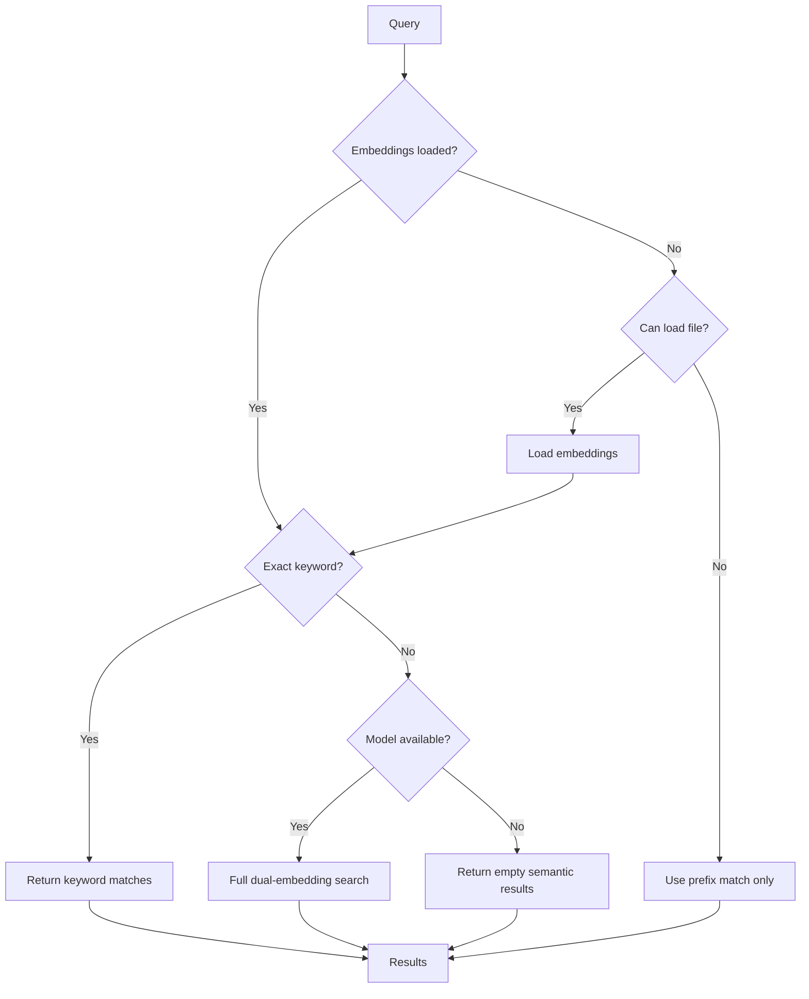

# Semantic Search System

This document describes the dual-embedding architecture used for intelligent tag suggestions.

## The Problem

Users often search for HED tags using terms that don't exactly match tag names:

| User types | Expected tag | Challenge |
|------------|--------------|-----------|
| marmoset | Animal | "marmoset" isn't in schema |
| horse | Animal | Need domain knowledge |
| listening | Hear | Verb form vs. tag name |
| elephant | Animal | Common word, not in schema |

Standard embedding models (like Qwen3) understand general language but lack neuroscience domain knowledge. For example, the embedding for "marmoset" is not naturally close to "Animal" because the model doesn't know marmosets are primates.

## The Solution: Dual-Embedding Architecture

We use two complementary embedding sets:



### Components

1. **Keyword Embeddings** (386 curated terms in `server/src/anchorKeywords.ts`)
   - Each keyword points to one or more HED schema tags; extension words are not targets, because extensions are unbounded words rather than tags
   - Examples: "marmoset" → [Animal, Animal-agent]
   - Acts as "anchors" that vote for tags

2. **Tag Embeddings** (1,994 HED tags)
   - Direct embeddings of tag names
   - Used for similarity matching

3. **Deterministic Index** (fallback)
   - Exact keyword → tag mappings
   - Instant lookup, no embedding needed

## Search Algorithm



### Step-by-Step Example

Query: **"bird"** (not in keyword index)

**Step 1: Generate query embedding**
```
embed("bird") → [0.12, -0.34, 0.56, ...]  # 1024 dimensions
```

**Step 2: Search keyword embeddings**
```
"bird" ↔ "dog":     0.75 → votes for [Animal, Animal-agent]
"bird" ↔ "cat":     0.72 → votes for [Animal, Animal-agent]
"bird" ↔ "horse":   0.70 → votes for [Animal, Animal-agent]
"bird" ↔ "fish":    0.68 → votes for [Animal, Animal-agent]

Keyword votes: {Animal: 4, Animal-agent: 4}
```

**Step 3: Search tag embeddings**
```
"bird" ↔ "Animal":   0.65
"bird" ↔ "Sound":    0.45
"bird" ↔ "See":      0.42

Direct matches: {Animal: 0.65, Sound: 0.45, See: 0.42}
```

**Step 4: Combine evidence**
```
Animal:
  - Keyword evidence: 4 votes, max similarity 0.75
  - Direct evidence: 0.65
  - BOTH sources → 1.5x boost
  - Combined score: 0.94

Sound:
  - Keyword evidence: none
  - Direct evidence: 0.45
  - Single source
  - Combined score: 0.45
```

**Result**: Animal ranks first with high confidence.

## Score Calculation

```typescript
// For tags with keyword votes
const keywordScore = maxSimilarity * (1 + Math.log(votes + 1) * 0.2);
const boostMultiplier = directSimilarity > 0 ? 1.5 : 1.0;
const combinedScore = keywordScore * boostMultiplier + directSimilarity * 0.3;

// For tags with only direct match
const combinedScore = directSimilarity;
```

## Similarity Thresholds

| Threshold | Value | Purpose |
|-----------|-------|---------|
| Keyword similarity | 0.6 | Minimum to consider keyword match |
| Tag similarity | 0.5 | Minimum for direct tag match |
| Top keywords | 10 | Number of similar keywords to use |
| Exact match score | 0.95 | Score for deterministic matches |
| Semantic cap | 0.94 | Maximum semantic match score |

## Embedding Model

- **Model**: Qwen3-Embedding-0.6B, `neuromechanist/Qwen3-Embedding-0.6B-ONNX-Q8` at `uint8`. The file is byte-identical to `onnx-community/Qwen3-Embedding-0.6B-ONNX` at `q8` (same SHA-256), so the shipped vectors and runtime queries use the same weights. Settings live in `server/src/embeddingConfig.ts`.
- **Dimensions**: 1024
- **Size**: ~600MB (downloaded on first use)
- **Pooling**: Last token
- **Normalization**: L2 normalized (cosine = dot product)
- **Query format**: raw (the query, lowercased, with no instruction). Documents are embedded bare. See [Evaluation](#evaluation) for the query-instruction experiment.

## Pre-computed Embeddings

Embeddings are pre-generated to avoid runtime model loading:

```
server/data/tag-embeddings.compact.json (~22MB, 2,008 tags and 386 keywords)
├── version: "3.0"
├── modelId: "neuromechanist/Qwen3-Embedding-0.6B-ONNX-Q8"
├── schemaVersion: "8.5.0,sc:score_2.1.0,la:lang_1.1.0"
├── dimensions: 1024
├── tags: [
│   { tag: "Animal", longForm: "Item/...", vector: [...] },
│   ...
│ ]
└── keywords: [
    { keyword: "marmoset", targets: ["Animal", "Animal-agent"], vector: [...] },
    ...
  ]
```

## Keyword Categories

The keyword index covers neuroscience-relevant terms:

| Category | Examples | Target Tags |
|----------|----------|-------------|
| Lab Animals | marmoset, macaque, mouse, rat | Animal, Animal-agent |
| Human Participants | subject, participant, patient | Human-agent, Experiment-participant |
| Stimuli | stimulus, target, distractor | Experimental-stimulus, Sensory-event |
| Timing | onset, offset, duration | Onset, Offset, Duration |
| Cognitive States | attention, focus, alert | Attentive, Alert |
| Emotions | happy, sad, fearful | Happy, Sad, Fearful |
| Sensory | visual, auditory, touch | See, Hear, Touch |
| Motor | press, click, saccade | Press, Move-eyes |
| Equipment | screen, headphones, keyboard | Computer-screen, Headphones |
| Neuroimaging | EEG, fMRI, spike | Measurement-event, Data-feature |

See [Extending](./extending.md) for how to add new keywords.

## Fallback Behavior

The system degrades gracefully:



## Performance

| Operation | Time | Notes |
|-----------|------|-------|
| Exact keyword lookup | <1ms | Hash table lookup |
| Embedding search | ~50ms | Pre-computed vectors |
| Model inference | ~200ms | Only when needed |
| File loading | ~500ms | Once at startup |

## Evaluation

The eval set (`server/eval/hed-examples-pairs.json`, format version 2) pairs 206 BIDS sidecar level descriptions with their HED strings, taken from `hed-examples` at commit `336a4fc`. The expected tags are the leaf tags of each string, resolved with the default HED schema (8.5.0). Dev and test are split by dataset.

The builder skips 56 pairs whose HED string does not validate under that schema, and 57 pairs with no leaf tags, such as definition-only or label-only strings. Most validation failures come from sidecar context that a standalone string cannot resolve, such as definition references and `{column}` placeholders, rather than from invalid annotations. The file records both counts.

Known limits of the set:

- 3 dev and 22 test pairs repeat another pair's query and expected tags. They are kept, because the set was frozen before the dev run.
- One dataset supplies 48 of the 96 dev pairs and 58 of the 110 test pairs, so pair-level intervals are optimistic.
- One study (`eeg_ds003645s`) appears in both splits as separate directories. Query text does not overlap between the splits.

Run the dev split with `bun run compile`, then:

```bash
node server/out/eval/evalSemantic.js --split dev
```

### Pre-registered experiment: query instruction

Three query formats were compared on the dev split (96 pairs): E0 raw, E1 Qwen's retrieval instruction, and E2 an HED-specific instruction. The gate required a variant to raise dev recall@10 by at least 2.0 points over E0. The test split was not read, because no variant cleared the gate.

Semantic-only results (`findSimilar`, top 10) on the default schema, with paired bootstrap 95% intervals against E0:

| Config | Query format | hit@10 | recall@10 | MRR | Recall@10 vs E0, points (95% CI) |
|--------|--------------|--------|-----------|-----|----------------------------------|
| E0 | raw | 32.3% | 16.3% | 0.198 | baseline |
| E1 | Qwen instruction | 16.7% | 8.7% | 0.126 | -7.6 [-13.2, -1.9] |
| E2 | HED instruction | 10.4% | 3.0% | 0.050 | -13.4 [-19.2, -8.1] |

Queries with no semantic candidate at all (dev, 96 queries): E0 1, E1 33, E2 45. Mean candidates per query: E0 9.8, E1 2.8, E2 2.3.

**Verdict:** neither instruction cleared the gate, so the runtime keeps the raw format and search behavior is unchanged.

An earlier run on schema 8.4.0 (before the extension cleanup and the regeneration) gave the same verdict: E1 -11.2 points and E2 -13.7 points of recall against a 32.3% E0 hit rate. Its numbers are not comparable with the table above.

**Confound 1, thresholds:** the similarity thresholds (0.6 for keyword votes, 0.5 for direct tag matches) were calibrated on raw queries. Instruction formats shift the similarity scale down, so most candidates fall below the thresholds. This experiment therefore measures the instructions together with the fixed thresholds. A fair comparison needs per-format thresholds calibrated on dev, which is a separate pre-registered experiment.

**Confound 2, batch composition:** the stored document vectors come from padded batches of 32, while runtime queries are embedded one at a time. A single-text embedding of a tag name differs from its stored vector by cosine 0.94 to 0.97 on sampled tags. Re-embedding the first 32 tags as a padded batch reproduces the stored vectors exactly, so the stored values depend on batch composition. Regenerating the index for schema 8.5.0 added 14 tags, which regrouped the batches: 1,962 of the 1,994 previously shipped tag vectors moved (mean cosine 0.950 to the old vector). The instruction comparison therefore also depends on how the documents were batched. Embedding each document alone would remove this dependence; that change is not made here.

## Future Improvements

1. **More keywords**: Add clinical, pharmacology, VR terms
2. **Learned weights**: Train keyword→tag weights from usage
3. **Contextual search**: Consider surrounding tags
4. **Typo tolerance**: Fuzzy matching for keywords
